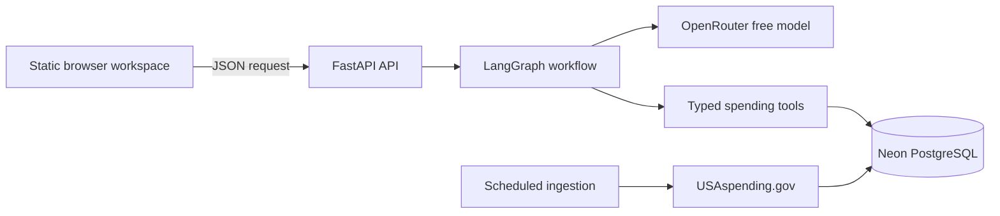

# FedLens

FedLens is an agentic federal spending analyst that turns natural-language questions into grounded, reproducible answers from official U.S. government data.

It combines a LangGraph workflow, a FastAPI service, typed PostgreSQL tools, Neon persistence, USAspending.gov ingestion, and a focused browser workspace. The language model handles intent and explanation; the database tool performs the factual retrieval and calculations.

## What It Does

Ask questions such as:

- How much did NASA spend by fiscal year?
- Compare NASA and the Department of Defense.
- What were the Department of Energy's FY2024 obligations?
- Show NASA outlays over time.

FedLens returns an answer with key figures, visual summaries, source provenance, and an observable activity trace showing how the request moved through the system.

## Architecture



The request path is deliberately separated from the ingestion path:

1. The frontend sends a natural-language question to `/v1/chat`.
2. LangGraph interprets and validates a typed query.
3. A data tool resolves the requested agency and queries Neon.
4. Deterministic analysis produces totals and chart series.
5. The model explains only the verified tool result.

User chat requests do not call USAspending.gov directly. The scheduled ingestion command refreshes annual agency aggregates and stores source URLs and ingestion status in Neon.

## Technology

- Python 3.12
- FastAPI and Uvicorn
- LangGraph and LangChain Core
- OpenRouter free-model routing through the OpenAI-compatible API
- Pydantic typed query and response contracts
- SQLAlchemy asyncio and asyncpg
- Neon PostgreSQL
- USAspending.gov official agency and budgetary-resources endpoints
- Static HTML, CSS, and JavaScript frontend
- Vercel frontend deployment and Render backend deployment

## Repository Layout

```text
fedlens/
├── backend/
│   ├── app/
│   │   ├── agent/          # LangGraph state and workflow nodes
│   │   ├── api/            # FastAPI routes
│   │   ├── clients/        # Government API clients
│   │   ├── database/       # Neon models, sessions, repositories
│   │   ├── ingestion/      # USAspending normalization
│   │   ├── schemas/        # Typed API and agent contracts
│   │   └── tools/          # Deterministic spending analysis
│   ├── scripts/            # Database and ingestion commands
│   └── tests/              # Unit and API tests
├── frontend/               # Static browser workspace
├── docs/                   # Architecture, data, evaluation, and project narrative
└── render.yaml             # Render web service and refresh job
```

## Local Setup

```bash
cd backend
python3.12 -m venv .venv
source .venv/bin/activate
python -m pip install -e ".[dev]"
```

Create `backend/.env` from `backend/.env.example` and provide:

```dotenv
LLM_PROVIDER=openrouter
LLM_MODEL=openrouter/free
OPENROUTER_API_KEY=your_openrouter_key
DATABASE_URL=postgresql+asyncpg://...
```

Initialize and load official annual data:

```bash
cd backend
python -m scripts.init_database
python -m scripts.ingest_usaspending \
  --agencies NASA DOD DOE \
  --start-year 2021 \
  --end-year 2025 \
  --replace-demo
```

## Run Locally

Start the backend:

```bash
cd backend
source .venv/bin/activate
python -m uvicorn app.main:app --host 127.0.0.1 --port 8000
```

Serve the frontend in a second terminal:

```bash
cd frontend
python3 -m http.server 4173
```

Open [http://127.0.0.1:4173](http://127.0.0.1:4173).

The backend exposes:

- `GET /health`
- `POST /v1/chat`

Example request:

```bash
curl -X POST http://127.0.0.1:8000/v1/chat \
  -H "Content-Type: application/json" \
  -d '{"thread_id":"demo","message":"How much did NASA spend in FY2025?"}'
```

## Data Model

FedLens stores compact annual aggregates rather than copying the national transaction corpus into the application database. Each spending record includes agency, fiscal year, period bounds, obligations, outlays, category, source URL, demo status, and update time. This keeps the query path fast, auditable, and inexpensive while preserving a clean boundary for future account-level and document sources.

## Testing

```bash
cd backend
source .venv/bin/activate
pytest
ruff check app scripts tests
```

The test suite covers typed query parsing, fiscal-year normalization, free-model fallback behavior, deterministic spending aggregation, comparison analysis, API responses, and USAspending normalization.

## Deployment

### Render

Use the root `render.yaml` Blueprint. Configure:

- `DATABASE_URL`
- `OPENROUTER_API_KEY`
- `CORS_ORIGINS`

The Blueprint defines the FastAPI web service and a scheduled USAspending refresh job.

### Vercel

Set the Vercel project root to `frontend`. Before deployment, set the public Render URL in `frontend/config.js`:

```js
window.FEDLENS_API_BASE_URL = "https://your-render-service.onrender.com";
```

Add the deployed Vercel origin to Render's `CORS_ORIGINS` value.

## Project Narrative

The application-ready project explanation is in [`docs/project-description.md`](docs/project-description.md).

## License

This project is available for portfolio and educational use.
